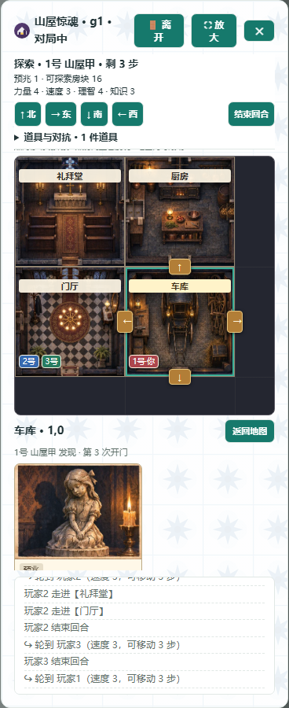
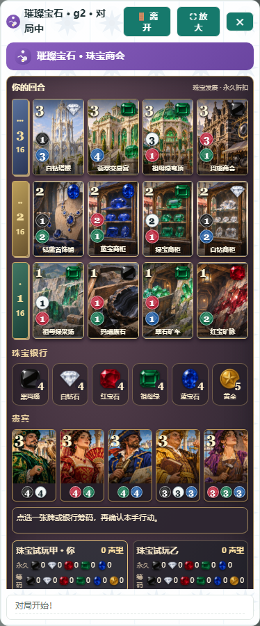

# 山屋拼图、宝石牌桌及其他游戏映射 · 2026-11-06

合并基线 c4b2754，受测源码 6a6f521。[山屋范围](../task-packages/MANOR-20261106.md) · [宝石范围](../task-packages/GEM-TABLE-20261106.md)。以下两张截图来自正式网页与合成房间。

| 山屋三人探索 | 宝石竖版牌桌 |
| --- | --- |
|  |  |

## 山屋惊魂

21 个正俯视房间、6 幅物品、8 幅事件、8 幅预兆由内置 ImageGen 原创绘制，桌面与网页共用图集。三名玩家同格可区分，门槛与合法移动共用坐标；地图、发现簿和道具背包依据服务器已经揭示的状态。开局门厅从待铺房间中剔除，以原本未用的房间补位，保持其他牌位、牌种和随机流。独立 32 个种子对照，包括攻击/死亡以外的探索、结束回合和 17 局正常撤离；原规则与专项另验战斗等路径。

真实 Hub/合成人物经正常入口开局。自然 seed 10 从门厅向北、东、南依序揭示礼拜堂/消防斧、厨房/幽灵低语、车库/少女雕像；四块拼图的坐标、再次进入旧房及已揭记录一致。另用自然 seed 3、1、92 核对意外馈赠双牌及水晶用途、暗门额外房间、惊魂远出口。桌面普通窗及 480×400 专注窗、桌面网页及 390px 手机视口已实拍，网页有攻击与幸存者撤离结果。

## 璀璨宝石

本次保留原项目三级各 20 张的简化规模。洗牌仅改变出牌顺序，每张牌的图、中文名、永久宝石、声望、费用固定。金色是万能币。三级竖图逐格复核，黑、白、红、绿、蓝各占一行。左上声望、右上永久宝石、左下费用由同一真实卡绘制；牌堆仅公布余量。两端实走获取筹码、直接买入、保留、买保留及收藏赏卡，蓝/绿卡的实际扣款和下一次折扣与画面一致，旧数据按实际奖励作中性回退。正式网页经 GRENDER 接入，支持 390px 及较矮宽屏。

## 跨游戏专题核查

对当前 50 款游戏按渲染家族清点，核规则或原始快照与表现映射，结论区分代码检查、后台探针及实际对局。七项确认问题均修正：

- 城主田/林图形对调，四季实际金币曾画作苹果；两端共用资源符号修正。
- 工坊的空位只按实际占用和分值显示，原“先手”提示去除，下一轮首位照常按座次轮换。
- 桌面 UNO 使用真实牌串绘四色普通牌与特殊牌；21 点保留 10 的完整点数及实际花色。
- 将棋角行升变的黑、白馬（编码 10/20）按正确类型绘制和行棋；验证升变后可横走并在被吃后还原为角行。
- 阿瓦隆角色码 2 对应刺客、3 对应莫德雷德；根据实际领袖、已投票者、任务队员及私有刺客状态显示操作。生产 renderer 的动作回放真实规则至好人与叛军胜局，观战者看不到私有身份说明。

## 最终回归

首轮 _tmp_gui/manor-gems-final 于第 18 文件提前停止：200 通过、1 失败。旧测试强制要求已被新设计取代的暖纸色，并使用没有 v2 图组的夹具。修订为真实竖图、奖励宝石、费用、牌堆、四个视图和旧数据回退，修订后私有桌面两文件 23 通过。首轮失败原件保留。

最终 _tmp_gui/manor-gems-verified 通过 fast_verify.py 优先 16 个相关文件，再完整覆盖 255 文件，无漏测或重复。3370 通过、0 失败、20 项默认跳过，退出 0，墙钟 2133.021 秒。源码标识 `d7643533bb0899683c2f35ddda7db8b03f7dadb1021ceed382e9f3769b888d16`。验证均未使用前台电脑；源码交付未构建 EXE、未实测物理手机或外机 LAN。
